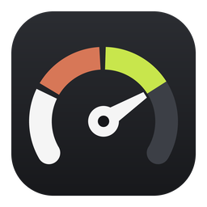
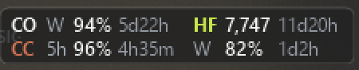

<p align="center"></p>

# ameter

Windows 작업표시줄에 Codex, Claude, Higgsfield의 **남은 사용량**을 두 줄로 띄우는 작은 미터입니다.



```
CO  W  94% 5d22h   HF 7,747 11d20h
CC  5h 96% 4h35m   W  82%   1d2h
```

| 이름 | 보여 주는 것 |
|---|---|
| `CO` | Codex 남은 사용량(5시간 `5h`, 주간 `W`)과 리셋까지 남은 시간 |
| `HF` | Higgsfield 남은 크레딧과 다음 월 충전까지 남은 시간 |
| `CC` | Claude 남은 사용량(5시간, 주간)과 리셋까지 남은 시간 |

- 남은 양이 30%·15%·5% 아래로 내려가면 숫자가 노랑·주황·빨강으로 바뀝니다. 한동안 갱신되지 않은 값은 흐리게 표시합니다.
- 리셋 시각이 지난 값은 0%로 꾸미지 않고 `—`로 표시합니다.
- 오른쪽 클릭 메뉴에서 코덱스, 클로드(주간·5시간), 힉스필드를 하나씩 켜고 끌 수 있습니다. 꺼진 항목은 조회도 멈춥니다. 더블클릭하면 바로 새로 고칩니다.
- 메뉴의 **미니 스타일**을 체크하면 이름 대신 각 서비스 색의 점을 쓰고, `5h`·`W` 라벨과 남은 시간을 빼고 숫자만 남겨 폭이 좁아집니다. 클로드 줄은 5시간, 주간 순서입니다.
  ```
  ● 99%  ● 7,747
  ● 93%    74%
  ```
- 전체 화면 앱(게임, 영상, 발표)이 떠 있는 동안에는 숨습니다.

## 어디서 읽나

전부 읽기 전용 조회입니다. 사용량이나 크레딧을 쓰는 호출은 하지 않고, 계정 이메일이나 조직 ID는 저장하지 않습니다.

| 항목 | 방법 | 주기 |
|---|---|---|
| Codex | 공식 `codex app-server`의 `account/rateLimits/read` | 1분 |
| Claude | claude.ai 사용량(로그인된 Aside 브라우저에서 `aside repl`로 조회), Claude Code 상태줄의 `rate_limits` | 2분, 상태줄이 갱신될 때 |
| Higgsfield | `higgsfield account status` / `account transactions` | 1분 (충전일은 6시간마다) |

- Aside 브라우저가 꺼져 있으면 claude.ai 조회를 건너뜁니다. 브라우저를 대신 띄우지 않습니다.
- Higgsfield는 다음 충전일을 따로 알려 주지 않습니다. 그래서 가장 최근 구독 크레딧 지급일에 한 달을 더해 계산합니다.

## 설치

1. [Releases](https://github.com/younkeunho/ameter/releases)에서 `ameter.exe`와 `ameter-cli.exe`를 받아 같은 폴더에 둡니다(예: `%LOCALAPPDATA%\Programs\ameter`).
2. `ameter.exe`를 실행합니다.
3. Windows에 로그인할 때 자동으로 켜지게 하려면:
   ```
   ameter-cli autostart on
   ```
4. Claude Code 상태줄과 연결하려면(선택):
   ```
   ameter-cli install-claude
   ```
   원래 쓰던 상태줄은 ameter 뒤에서 그대로 실행되므로 출력도 그대로입니다. 바꾸기 전 설정은 백업해 두고, `ameter-cli uninstall-claude`로 원래대로 되돌립니다.

쓰는 서비스의 CLI만 있으면 됩니다. Codex는 `npm i -g @openai/codex`를 설치한 뒤 `codex login`, Higgsfield는 `npm i -g @higgsfield/cli`를 설치한 뒤 로그인합니다. Claude는 claude.ai에 로그인된 Aside 브라우저 또는 Claude Code가 필요합니다.

## ameter-cli

| 명령 | 하는 일 |
|---|---|
| `install-claude [--passthrough "<명령>"]` | Claude Code 상태줄 연결. `--passthrough`로 뒤에서 실행할 상태줄을 직접 지정 |
| `uninstall-claude` | 연결 해제, 원래 상태줄 복원 |
| `autostart on` / `off` | Windows 시작 시 자동 실행 |
| `print` | 지금 값을 터미널에 출력 |
| `claude-statusline` | Claude Code가 부르는 상태줄 명령(직접 쓸 일은 없음) |

## 파일

`%LOCALAPPDATA%\ameter`에 값 캐시(`codex.json`, `claude.json`, `higgsfield.json`), 메뉴 설정(`display.json`), 로그, Claude 설정 백업(`backups\`)을 둡니다. 다음 환경 변수로 위치를 바꿀 수 있습니다: `AMETER_DATA_DIR`, `AMETER_CODEX_PATH`, `AMETER_HIGGSFIELD_PATH`, `AMETER_ASIDE_PATH`.

## 빌드

```
cargo build --release
cargo test
```

`x86_64-pc-windows-gnu` 툴체인에서 빌드하고 테스트했습니다. 아이콘과 버전 정보는 `build.rs`가 직접 실행 파일에 넣으므로 rc.exe나 windres 같은 리소스 컴파일러는 필요 없습니다. 아이콘은 `python assets/icon.py`(Pillow)로 다시 그립니다.

## 라이선스

[MIT](LICENSE) © 2026 younkeunho
